# Project flow and folder guide

## What this project does

`nutrition-rag` builds a curated, evidence-ranked corpus about diabetes
prevention, weight management, and maternal nutrition, with extra searches for
Indian and South Asian research. It currently implements data ingestion and
local-model extraction/review. The indexing, question-answering, and end-user
application parts are future phases; the folder names and CLI commands for
those parts do not mean those features are already working.

## End-to-end flow

```mermaid
flowchart TD
    User["Developer / researcher"] --> CLI["nrag CLI (src/nrag/cli.py)"]
    Config["config.yaml + optional .env"] --> CLI
    CLI --> Ingest["nrag ingest"]

    Ingest --> Query["Build topic queries<br/>+ India/South Asia boost"]
    Query --> PubMed["PubMed E-utilities<br/>year/date slices; optional sample"]
    PubMed --> Cache["data/cache/ncbi<br/>rate-limited, retried HTTP cache"]
    Cache --> Records["Parse PubMed XML<br/>merge new hits + refresh stored PMIDs"]
    Store[("data/interim/pubmed_records.jsonl<br/>persistent raw/parsed PubMed store")] --> Records
    Records --> Store

    Records --> External["Refresh external checks"]
    External --> NLM["NLM Catalog<br/>MEDLINE journal status"]
    External --> RW["Retraction Watch<br/>DOI/PMID notices"]
    External --> CacheWeb["data/cache/web"]
    CacheWeb --> RW

    Records --> Derive["Derive fields<br/>design, sample size, scores, flags"]
    NLM --> Derive
    RW --> Derive
    Derive --> Hygiene{"Basic exclusions +<br/>credibility policy"}
    Hygiene -->|"included / provisional"| Dedupe["DOI de-duplication<br/>propagate retractions"]
    Hygiene -->|"excluded + reason"| Excluded["data/corpus/excluded.jsonl"]
    Dedupe --> FullText["Optional PMC full text<br/>parse JATS; enforce licence allowlist"]
    FullText --> Guidelines["Optional registered guideline PDFs<br/>parse sections, tables, graded recommendations"]
    Guidelines --> Corpus["Sort by quality score and write corpus"]
    Dedupe --> Corpus
    Corpus --> Docs["data/corpus/documents.jsonl"]
    Corpus --> Outputs["fulltext/*.json, summary.json,<br/>removals_log.jsonl"]

    Docs --> ExtractCLI["nrag extract"]
    ExtractCLI --> Select["Select screen / review sample<br/>or all PMID documents"]
    Select --> Prompt["Versioned PICO prompt<br/>+ strict Pydantic JSON schema"]
    Prompt --> Ollama["Local LLM endpoint<br/>(configured Ollama / compatible API)"]
    Ollama --> Validate["Validate JSON and enums;<br/>retry invalid output; check source quotes"]
    Validate --> LLMCache["data/cache/llm<br/>keyed by exact extraction inputs"]
    LLMCache --> Result["data/interim/extractions/&lt;system&gt;.jsonl<br/>failures.jsonl"]
    Result --> Blind["nrag extract-compare<br/>blinded human review CSV + key"]
    Blind --> Human["Researcher labels verdicts / gold values"]
    Human --> Accuracy["nrag extract-accuracy"]
    Accuracy --> Metrics["Accuracy, kappa, tag P/R/F1,<br/>numeric tolerance, bootstrap CI,<br/>McNemar, rules baseline, decision"]
    Metrics --> Report["eval/reports/"]

    Docs -. "Phase 3: score / supersession" .-> FutureScore["Evidence score v2"]
    Result -. "after validated extraction is approved" .-> FutureScore
    FutureScore -. "Phase 4: index" .-> FutureIndex["Chunk + hybrid indexes<br/>vector + BM25 (planned)"]
    FutureIndex -. "Phase 6/8: ask" .-> FutureRetrieve["Retrieve / rank evidence<br/>then generate cited answer (planned)"]
    FutureRetrieve -. "Phase 7: eval / ablate / failures / compare" .-> FutureEval["Golden-set evaluation<br/>and failure analysis (planned)"]
```

Solid arrows are implemented paths. Dashed arrows describe the intended
downstream RAG flow; those components are not yet implemented.

## What happens in each implemented flow

### 1. Ingestion (`nrag ingest`)

1. The CLI loads `config.yaml` (or `--config` / `NRAG_CONFIG`) and constructs
   separate cached HTTP clients for NCBI and other web sources. NCBI identity
   values are read from the environment or `.env`.
2. PubMed searches run for configured topics and, when enabled, additional
   India/South Asia queries. Queries are split by year and further by date if
   needed to stay within PubMed's result limit. `--max-per-topic` samples
   across years; `--since` uses entry date for incremental refreshes.
3. The PMID store is merged with new hits. Previously stored records are also
   fetched again (subject to the configured cache TTL) so updated MeSH,
   retraction, and expression-of-concern information can change the corpus.
4. PubMed XML is parsed. The pipeline checks journal MEDLINE status through
   the NLM Catalog and retraction/expression-of-concern notices through the
   Retraction Watch data feed.
5. Records receive a study-design classification, estimated sample size,
   hygiene checks, credibility status, and a configurable quality score.
   Records can be included, provisional, or excluded with a reason. DOI
   duplicates are consolidated, and a retraction can exclude DOI duplicates.
6. For eligible PMC records, full text is stored only when the licence is on
   the allowlist. Registered guidelines are parsed only when their local PDFs
   are present.
7. The corpus and excluded list are rewritten from current inputs. Documents
   that disappeared since the previous corpus are appended to the removals
   log; a summary records counts and run settings.

The raw/parsed PubMed store and derived corpus are different: the store keeps
fetched records for refreshing and rebuilding; `documents.jsonl` is the
screened output used by the extraction step.

### 2. PICO extraction and quality review

`nrag extract` reads PMID documents from the corpus, chooses a stratified
screen/review sample (or all documents), and sends title and abstract to a
configured local LLM endpoint. A strict schema constrains extraction fields;
Pydantic validates responses, validation errors are fed back for retry, and
quoted evidence is checked against the source text. Extraction results are
cached by model, reasoning setting, prompt, schema, and input text.

`nrag extract-compare` makes a blinded review spreadsheet; a separate key maps
the anonymized systems. A researcher fills in verdicts and any corrected
values. `nrag extract-accuracy` compares model results with those labels and a
rules-only baseline, then writes a report and JSON metrics. Extraction results
are currently kept separate from the corpus: `extract.apply_to_corpus` is
false until the review supports applying them.

### 3. Intended future RAG path

The CLI describes later stages: improve evidence scoring and supersession,
build vector and BM25 indexes, retrieve and rank evidence, generate an answer
with citations, then evaluate on a golden set and run ablations/failure
analysis. `score`, `index`, `ask`, `eval`, `ablate`, `failures`, and `compare`
currently exit with “Not implemented yet.”

## Folder-by-folder guide

| Path | Purpose and current state |
|---|---|
| `src/nrag/` | Installable Python package and CLI implementation. |
| `src/nrag/ingest/` | Implemented source collection, parsing, screening, scoring, full-text, and guideline ingestion. |
| `src/nrag/extract/` | Implemented local LLM extraction, schema/prompt, caching glue, and human-review metrics. |
| `src/nrag/extract/prompts/` | Versioned prompts; `pico_v1.md` is the current extraction prompt. |
| `src/nrag/index/` | Reserved for indexing; currently only package initialization exists. |
| `src/nrag/retrieve/` | Reserved for retrieval; currently only package initialization exists. |
| `src/nrag/score/` | Reserved for later scoring/supersession work; currently only package initialization exists. |
| `src/nrag/generate/` | Reserved for answer generation; currently only package initialization and an empty prompts directory exist. |
| `src/nrag/eval/` | Reserved for future RAG evaluation; currently only package initialization exists. Extraction evaluation is implemented in `extract/review.py`. |
| `data/cache/` | Generated HTTP and LLM response caches, split into NCBI, web, and LLM caches. Avoids repeat requests/model calls. |
| `data/interim/` | Intermediate generated data: the persistent PubMed record store and per-model extraction outputs/failures. |
| `data/corpus/` | Generated curated corpus: included/provisional documents, excluded reasons, summary, removals log, and full-text JSON. |
| `data/guidelines/` | Version-controlled `registry.yaml` plus local guideline PDFs supplied by the researcher. PDFs are not included by default. |
| `data/raw/` | Reserved for raw downloaded source material; currently a placeholder. |
| `data/index/` | Reserved for persisted search indexes; currently a placeholder. |
| `eval/` | Human labels and evaluation artifacts. `REVIEW_GUIDE.md` documents extraction annotation; reports and run folders are output locations. |
| `eval/reports/` | Generated accuracy and later evaluation reports. |
| `eval/runs/` | Generated evaluation-run outputs; these are ignored by Git. |
| `app/` | Reserved for a future Streamlit/API user interface; currently just a placeholder. |
| `legacy/` | Original ingestion script retained for historical parity checks; the active implementation is under `src/nrag/ingest/`. |
| `tests/` | Offline unit and integration tests for CLI/config, parsing, ingestion, screening, extraction, and review. |
| `tests/fixtures/` | Synthetic PubMed/PMC XML and Retraction Watch data used by tests; fixtures are not live research records. |
| `.github/workflows/` | CI workflow: tests on supported Python versions and builds/runs the Docker CLI image. |

## Important root files

| File | Role |
|---|---|
| `config.yaml` | Single source of truth for topics, queries, thresholds, licences, paths, cache TTLs, LLM and review settings. |
| `pyproject.toml` | Package metadata, dependencies/extras, `nrag` entry point, and pytest configuration. |
| `Makefile` | Shortcuts for setup, ingest/extract, future phases, testing, and Docker commands. |
| `Dockerfile` | Builds the CLI image; data, secrets, and caches are mounted at runtime rather than copied into it. |
| `docker-compose.yml` | Local app + AlloyDB Omni/Postgres-compatible database stack; database is bound to localhost. |
| `.env.example` | Names/examples for optional local environment settings; actual secrets belong in ignored `.env` or the environment. |
| `.gitignore` | Excludes local environments, secrets, generated corpus/cache data, and evaluation runs while retaining placeholders and the guideline registry. |
| `CLAUDE.md` | Project architecture, operating conventions, current phase status, and known limitations. |

## Current implementation boundary

Implemented: PubMed ingestion, cached/rate-limited HTTP, credibility screening,
MEDLINE and retraction checks, licence-gated PMC full text, registry-based
guideline parsing, local-model PICO extraction, and extraction accuracy
review.

Not yet implemented: Phase 3 corpus scoring/supersession command, Phase 4
retrieval index construction, later answer/retrieval and RAG evaluation
commands, and the end-user app. Docker and CI scaffolding exists, but the
presence of the compose database does not mean the current ingestion/extraction
flow uses it.
